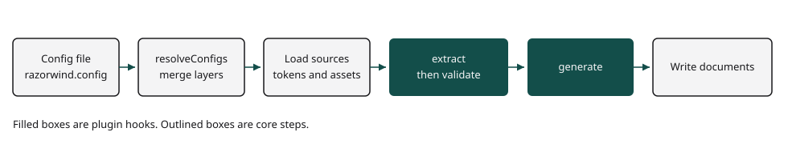

# Razorwind core

`@razorwind/core` is the Razorwind generator. It loads design tokens, components, icons, fonts, and guidelines. It then runs the plugins in your configuration.

Use a plugin package when you need a specific output, such as CSS, Tailwind CSS, or a theme file. Use this package to define the configuration and to author a new plugin.

The filled steps are plugin hooks. The outlined steps belong to core.

## Pages

- [Installation](./installation.md)
- [Quick start](./quick-start.md)
- [Generate walk-through](./guides/generate.md)
- [Configuration](./configuration.md)
- [API reference](./api-reference.md)
- [Troubleshooting](./troubleshooting.md)

## Package map

| Package | Role |
| --- | --- |
| [`@razorwind/cli`](../../cli/docs/index.md) | Run generate, clean, test, and garbage collection. |
| [`@razorwind/preset`](../../preset/docs/index.md) | Map tokens once and pass that theme to several generators. |
| [`@razorwind/css`](../../css/docs/index.md) | Write or read CSS custom properties. |
| [`@razorwind/tailwindcss`](../../tailwindcss/docs/index.md) | Write or read Tailwind CSS, plus lint guardrails. |
| [`@razorwind/style-dictionary`](../../style-dictionary/docs/index.md) | Run Style Dictionary platforms. |
| [`@razorwind/theme-seeds`](../../theme-seeds/docs/index.md) | Build semantic tokens from numeric seeds. |
| [`@razorwind/color-variants`](../../color-variants/docs/index.md) | Add color-variant token sets during extract. |
| [`@razorwind/design-md`](../../design-md/docs/index.md) | Write or read `DESIGN.md`. |
| [`@razorwind/docgen`](../../docgen/docs/index.md) | Write MDX token and component docs. |
| [`@razorwind/storybook`](../../storybook/docs/index.md) | Write Storybook MDX token blocks. |
| [`@razorwind/llms`](../../llms/docs/index.md) | Write `llms.txt` files. |
| [`@razorwind/json-render`](../../json-render/docs/index.md) | Write a json-render catalog. |
| [`@razorwind/shadcn`](../../shadcn/docs/index.md) | Write or read a shadcn registry. |
| [`@razorwind/eslint`](../../eslint/docs/index.md) | Write an ESLint plugin from the schema. |
| [`@razorwind/stylelint`](../../stylelint/docs/index.md) | Write a Stylelint plugin from the schema. |
| [`@razorwind/tamagui`](../../tamagui/docs/index.md) | Write a Tamagui config. |
| [`@razorwind/benchmark`](../../benchmark/docs/index.md) | Score agent output against the design system. |
| [`@razorwind/nx`](../../nx/docs/index.md) | Add an Nx generate target for each config file. |
| [`@razorwind/shell-shock`](../../shell-shock/docs/index.md) | Write a Shell Shock theme and design-system commands. |
| [`@razorwind/shiki`](../../shiki/docs/index.md) | Write Shiki themes. |
| [`@razorwind/sandpack`](../../sandpack/docs/index.md) | Write Sandpack themes and usage demos. |
| [`@razorwind/vsce`](../../vsce/docs/index.md) | Write a VS Code theme extension. |
| [`@razorwind/cursor`](../../cursor/docs/index.md) | Write a Cursor theme extension. |
| [`@razorwind/zed`](../../zed/docs/index.md) | Write a Zed theme extension. |
| [`@razorwind/chrome`](../../chrome/docs/index.md) | Write a Chrome theme extension. |
| [`@razorwind/vivaldi`](../../vivaldi/docs/index.md) | Write a Vivaldi theme. |
| [`@razorwind/thunderbird`](../../thunderbird/docs/index.md) | Write a Thunderbird theme. |
| [`@razorwind/ghostty`](../../ghostty/docs/index.md) | Write a Ghostty theme. |
| [`@razorwind/zsh`](../../zsh/docs/index.md) | Write an Oh My Zsh theme. |
| [`@razorwind/notepad-plus-plus`](../../notepad-plus-plus/docs/index.md) | Write a Notepad++ theme. |
| [`@razorwind/maplibre`](../../maplibre/docs/index.md) | Write MapLibre styles. |
